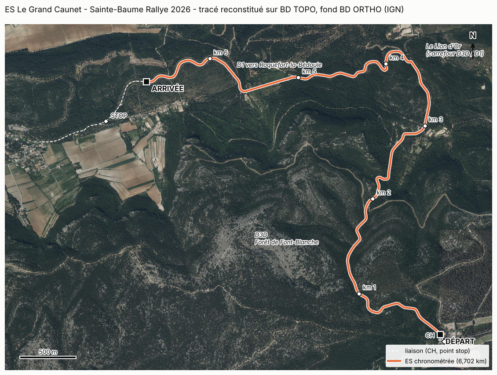

# ES « Le Grand Caunet » pour Assetto Corsa Rally

Reproduction de l'épreuve spéciale « Le Grand Caunet » (6,702 km, asphalte, Sainte-Baume Rallye 2026, Bouches-du-Rhône) pour la simulation.



## État du projet

| Phase | Contenu | État |
|---|---|---|
| 0 | Étude de faisabilité | Fait : [`docs/01_etude_faisabilite.md`](docs/01_etude_faisabilite.md) |
| 1 | Choix de la spéciale | Fait : ES « Le Grand Caunet », 6,702 km |
| 2 | Identification GPS, cartographie, relief, données géographiques | Fait : [`docs/02_phase2_donnees_geographiques.md`](docs/02_phase2_donnees_geographiques.md) |
| 3 | Axe et bords de chaussée précis, dévers | Première version : [`docs/03_phase3_chaussee.md`](docs/03_phase3_chaussee.md). Lignes de départ et d'arrivée à verrouiller sur vidéo |
| 4 | Terrain et route en 3D | Premier modèle neutre (glTF) dans `modele/` ; à enrichir |
| 5 et 6 | Décor : route texturée et marquée, ponts, parapets, glissières, carrefours, arbres, sol sans les arbres, paysage lointain | Fait dans le modèle neutre : [`docs/07_phase4_decor.md`](docs/07_phase4_decor.md) et [`docs/09_phase5_paysage_sol.md`](docs/09_phase5_paysage_sol.md). Pas encore dans le jeu : protocole dans [`pc/etape2_unreal/PROTOCOLE.md`](pc/etape2_unreal/PROTOCOLE.md) |
| 7 | Export et intégration dans le jeu | Export complet au format d'échange d'ACR Extra Stages (sol, obstacles, notes) : [`docs/05_export_stage_ir.md`](docs/05_export_stage_ir.md). **Kit d'essai pour le PC prêt mais jamais exécuté : [`pc/LISEZMOI.md`](pc/LISEZMOI.md)** |
| 8 | Notes du copilote, chrono, tests en jeu | Notes calculées puis retouchées d'après la vidéo ([`docs/08_releve_video.md`](docs/08_releve_video.md)). Tests en jeu : à faire sur le PC du directeur |

**À savoir avant tout** : Assetto Corsa Rally (version 0.6) ne propose officiellement que des livrées personnalisées. Des spéciales non officielles existent pourtant depuis fin octobre 2026, dont une construite à partir de données cartographiques publiques. Le projet vise donc Assetto Corsa Rally par cette voie non officielle, encore expérimentale, en gardant des données et un modèle 3D indépendants du jeu. Le détail est dans l'étude de faisabilité.

## Contenu

```
docs/                 rapports numérotés, vidéos embarquées, guide du directeur,
                      feuille de route pour une session sur son PC (06)
figures/              carte générale, profil en long, zooms départ et arrivée
data/reference/       points GPS et PK de la carte officielle de l'organisateur
data/processed/       tracé (GeoJSON, GPX, KML), profil au mètre, virages, ponts,
                      carrefours, relief à 1 m, décor dans le couloir
data/raw/             relief 0,5 m, photo aérienne 20 cm (non versionnés, 220 Mo)
modele/               premier modèle 3D (glTF) : route et terrain du couloir
export/               spéciale au format d'échange d'ACR Extra Stages (Stage IR)
pc/                   kit d'essai pour le PC Windows : pas-à-pas, scripts, retouches du constructeur
scripts/              chaîne de traitement, rejouable de bout en bout
```

Pour voir le tracé sans rien installer : ouvrir `data/processed/trace_es.kml` dans Google Earth.

## Rejouer les phases 2 et 3

```bash
pip install -r requirements.txt
scripts/tout_lancer.sh        # quelques minutes, accès à data.geopf.fr requis
```

## Sources et licences

- Données géographiques : IGN (LiDAR HD, BD ORTHO, BD TOPO, BD Forêt), Licence Ouverte Etalab 2.0.
- Points de l'ES : carte officielle de l'ASA Marseille Provence Métropole, dont seules les coordonnées et distances sont reprises.
