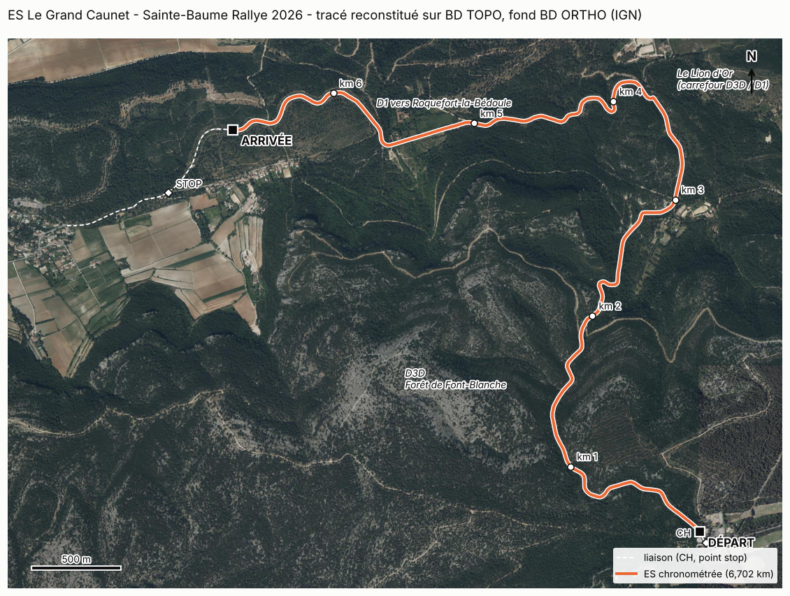
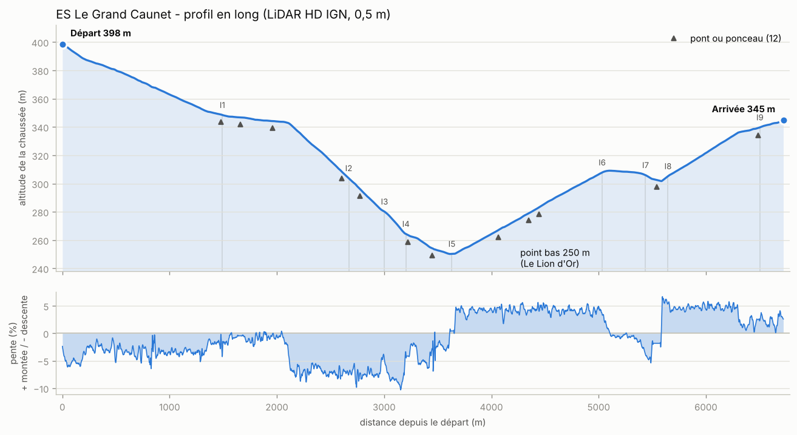

# Phase 2 : identification GPS, cartographie, relief et données géographiques

*ES « Le Grand Caunet », 6,702 km. Situation au 10 novembre 2026. Document destiné au directeur de projet.*

> **Changement d'origine des PK (10/11/2026).** Sur décision du directeur, d'après la vidéo embarquée de 2025, la ligne de départ a été reculée de 20 m. Le PK 0 du projet est désormais cette ligne, et l'arrivée, inchangée sur le terrain, se trouve au PK 6 722. **Les PK cités ci-dessous datent d'avant ce changement : ajoutez-leur 20 m** pour les retrouver dans les fichiers actuels.

## 1. Résultat

La spéciale est identifiée, tracée et mesurée, et toutes les données géographiques utiles à sa reconstruction sont collectées.

- **Parcours confirmé** par la carte officielle de l'organisateur : départ au carrefour du Grand Caunet, descente par la **D3D** à travers la forêt de Font-Blanche jusqu'au carrefour du **Lion d'Or**, puis remontée par la **D1** en direction de Roquefort-la-Bédoule.
- **Contrôle de distance** : le tracé reconstitué retombe sur les 9 points intermédiaires officiels avec un écart type de 6,9 m (13 m au pire) sur 6,7 km.
- **Relief** : relevé laser aérien de l'IGN (LiDAR HD), un point tous les 50 cm, disponible sur toute la spéciale.
- **Lignes de départ et d'arrivée** : fixées depuis sur vidéo embarquée, à une quinzaine de mètres près (voir `references_videos.md`).

## 2. Identification de la spéciale

| | |
|---|---|
| Rallye | Sainte-Baume Rallye 2026 (Rallye National de la Sainte-Baume), ASA Marseille Provence Métropole, Coupe de France des Rallyes |
| Dates | 12 au 14 novembre 2026 |
| Épreuve | E.S. 7 et 10 « Le Grand Caunet » |
| Longueur officielle | 6,702 km |
| Revêtement | Asphalte |
| Routes | D3D sur 3,6 km, puis D1 sur 3,1 km |
| Commune | Roquefort-la-Bédoule (Bouches-du-Rhône) pour toute la partie chronométrée |
| Source | Carte officielle « E.S. 7, 10 Le Grand Caunet.pdf », [site de l'ASA Marseille](https://www.asamarseille.net/sainte-baume-rallycircuit-engagements), créée le 01/06/2026 |

**Sur le choix de l'édition.** La longueur de 6,702 km correspond aux éditions 2025 (ES 1 et 4) et 2026 (ES 7 et 10). Le directeur confirme que ces deux tracés sont identiques ; la carte 2026, seule encore en ligne chez l'organisateur, sert de référence. Les éditions 2020 à 2023 utilisaient une version de 6,89 km et les plus anciennes une version de 7,0 km : mêmes routes, lignes de départ ou d'arrivée placées un peu différemment. Leurs vidéos embarquées restent donc utilisables pour le décor et la route.

Les 15 points de la carte officielle (contrôle horaire, départ, 9 points intermédiaires, arrivée, point stop) sont recopiés dans `data/reference/es_grand_caunet_2026_officiel.json`.

## 3. Méthode de reconstitution du tracé

1. Le réseau routier vient de la **BD TOPO de l'IGN**, la base cartographique de référence, qui donne l'axe de chaque route en 3D.
2. Chaque point officiel est accroché à la route (D3, D3D ou D1) la plus proche.
3. Le tracé est le plus court chemin routier d'un point au suivant.
4. Les distances mesurées sur ce tracé sont comparées aux PK officiels (les distances depuis le départ, relevées au compteur par l'organisateur).

| Point | PK officiel (m) | PK mesuré (m) | Écart (m) | Distance à la route (m) |
|---|---:|---:|---:|---:|
| CH (contrôle horaire) | −105 | −96 | +9 | 0,3 |
| Départ | 0 | (voir § 4) | | 81,6 |
| Inter 1 | 1 485 | 1 472 | −13 | 8,6 |
| Inter 2 | 2 650 | 2 650 | 0 | 0,4 |
| Inter 3 | 2 987 | 2 983 | −4 | 1,6 |
| Inter 4 | 3 192 | 3 183 | −9 | 1,1 |
| Inter 5 (Lion d'Or) | 3 619 | 3 612 | −7 | 1,9 |
| Inter 6 | 5 003 | 5 013 | +10 | 3,6 |
| Inter 7 | 5 416 | 5 417 | +1 | 2,2 |
| Inter 8 | 5 620 | 5 627 | +7 | 4,0 |
| Inter 9 | 6 483 | 6 484 | +1 | 2,5 |
| Arrivée | 6 702 | 6 733 | +31 | 0,6 |
| Point stop | 7 263 | 7 282 | +19 | 4,8 |

Entre l'Inter 1 et l'Inter 9, l'organisateur compte 4 998 m et le tracé en mesure 5 012, soit 0,3 % d'écart. Le parcours ne fait donc aucun doute.

Après le point stop, le dernier point de la carte (PK 8,020, fin de la zone fermée) ne correspond pas : 103 m d'écart. Il se trouve hors de la partie chronométrée, sur la liaison ; je ne l'ai pas approfondi.

## 4. Lignes de départ et d'arrivée : à verrouiller

Les coordonnées GPS imprimées sur la carte officielle sont **indicatives**, pas exactes :

- le point « Départ » imprimé tombe à 82 m de la D3D, sur une piste du centre équestre voisin ;
- le point « Arrivée » imprimé se trouve 31 m plus loin que ce que donnent les PK.

J'ai donc retenu les **distances officielles** comme référence, et non les coordonnées imprimées. L'origine des PK est placée de façon à annuler l'écart médian sur les 9 points intermédiaires.

| Ligne | Position retenue (WGS84) | Coordonnée imprimée sur la carte |
|---|---|---|
| Départ | 43,235588° N, 5,670158° E | 43,23643° N, 5,67042° E (hors route) |
| Arrivée | 43,257355° N, 5,637769° E | 43,25739° N, 5,63739° E (31 m plus loin) |

L'incertitude est d'environ 30 m sur chaque ligne. Elle n'a pas de conséquence sur la construction : la route sera modélisée du contrôle horaire jusqu'au point stop, et les lignes sont de simples repères déplaçables. Elle se lèvera avec une vidéo embarquée, qui montre l'emplacement réel des panneaux (voir § 10).

Les figures `figures/zoom_depart.png` et `figures/zoom_arrivee.png` montrent les deux zones sur la photo aérienne, graduées en PK.

## 5. Relief

| | |
|---|---:|
| Altitude au départ | 398 m |
| Point bas (PK 3 591, carrefour du Lion d'Or) | 250 m |
| Altitude à l'arrivée | 345 m |
| Dénivelé négatif cumulé | 155 m |
| Dénivelé positif cumulé | 102 m |
| Pente maximale en descente | 10,3 % |
| Pente maximale en montée | 6,7 % |
| Longueur mesurée en tenant compte du relief | 6 707 m |

La spéciale se lit en trois temps : 3,6 km de descente sur la D3D, d'abord douce puis à 6 à 10 % après le PK 2 000 ; un virage à angle droit au Lion d'Or ; puis 3,1 km de montée régulière à 4 ou 5 % sur la D1, coupée par un faux plat descendant entre les PK 5 000 et 5 500.

**Ponts et ponceaux.** Le relevé laser décrit le sol nu, donc le fond du vallon sous un pont et non le tablier. La BD TOPO signale 14 ouvrages sur la spéciale ; 12 franchissent un creux d'au moins 1 m, le plus haut de 6,8 m (PK 5 492 à 5 551). Sur ces tronçons, l'altitude de la chaussée est interpolée entre les deux extrémités de l'ouvrage. La liste est dans `data/processed/ouvrages_es.csv`.

## 6. Géométrie de la route

| | |
|---|---|
| Largeur de chaussée (BD TOPO) | 7 m sur 6,05 km ; 6,5 m sur 0,65 km, juste avant le Lion d'Or |
| Virages recensés | 67, dont 37 à gauche et 30 à droite |
| Virages très serrés (rayon inférieur à 15 m) | 5 |
| Plus longue portion sans virage | 442 m, du PK 5 039 au PK 5 481 |
| Voies qui débouchent sur l'ES | 40 : 1 route (la D1 au Lion d'Or), 13 pistes empierrées, 10 chemins, 16 sentiers |

**Ces chiffres de virages sont indicatifs.** L'axe de la BD TOPO est annoncé à 2,5 m près : c'est suffisant pour mesurer des distances et un profil, pas pour un rayon de virage. Le rayon de 5 m calculé au Lion d'Or, par exemple, vient de l'angle vif que fait la carte au carrefour. La largeur de 7 m est elle aussi une valeur de base de données, à vérifier sur la photo. L'axe et les bords de chaussée seront redessinés en phase 3.

## 7. Décor le long de la route

Dans une bande de 100 m de part et d'autre de l'axe (BD Forêt de l'IGN) :

| Végétation | Part |
|---|---:|
| Forêt fermée de pin d'Alep | 39 % |
| Lande | 12 % |
| Forêt fermée mêlée, feuillus dominants | 12 % |
| Forêt fermée de chênes verts | 11 % |
| Forêt ouverte de conifères | 7 % |
| Autres forêts | 11 % |
| Sans forêt cartographiée (route, cultures, bâti) | 9 % |

- **Hauteur des arbres** (différence entre les deux relevés laser, surface et sol, entre 5 et 30 m de l'axe) : le couvert dépasse 2 m sur 58 % de la surface ; hauteur médiane 9 m, 10 % des arbres à plus de 16,6 m.
- **Bâtiments** : 18 à moins de 50 m de l'axe et 250 à moins de 300 m, presque tous aux deux extrémités : centre équestre avant le départ, abords de Roquefort après le point stop. Sur la partie chronométrée, seuls 2 bâtiments sont à moins de 50 m de la route, vers le PK 5 450.
- Aussi collectés : 47 haies, 33 murs et clôtures, 50 tronçons de cours d'eau (des vallons secs pour l'essentiel), 2 réservoirs.

## 8. Données collectées

| Donnée | Source IGN | Précision | Fichier | Dans le dépôt |
|---|---|---|---|---|
| Points officiels de l'ES | Carte de l'organisateur | 5 décimales, indicatif | `data/reference/es_grand_caunet_2026_officiel.json` | Oui |
| Tracé de l'ES | BD TOPO | 2,5 m en plan | `data/processed/trace_es.geojson`, `.gpx`, `.kml` | Oui |
| Profil au mètre | LiDAR HD + BD TOPO | quelques cm en altitude | `data/processed/profil_es.csv` | Oui |
| Virages, ponts, carrefours | calculés | indicatif | `virages_es.csv`, `ouvrages_es.csv`, `carrefours_es.csv` | Oui |
| Relief du couloir, maille 1 m | LiDAR HD (sol) | 150 m de chaque côté | `data/processed/mnt_couloir_1m.tif` | Oui (4,5 Mo) |
| Décor à moins de 300 m | BD TOPO, BD Forêt | métrique | `data/processed/couloir/*.geojson` | Oui |
| Relief, maille 0,5 m | LiDAR HD (sol) | 300 m de chaque côté | `data/raw/mnt_lidarhd_50cm.tif` | Non (70 Mo) |
| Surface avec arbres et bâti, maille 0,5 m | LiDAR HD (surface) | idem | `data/raw/mns_lidarhd_50cm.tif` | Non (84 Mo) |
| Photo aérienne, 20 cm par pixel | BD ORTHO | idem | `data/raw/ortho_20cm.tif` | Non (46 Mo) |

Les trois gros fichiers ne sont pas stockés sur GitHub. Ils se retéléchargent en quelques minutes avec `scripts/tout_lancer.sh`.

Toutes les données IGN sont sous Licence Ouverte Etalab 2.0 : réutilisation libre en citant « IGN ». Le fichier `trace_es.kml` s'ouvre directement dans Google Earth.

## 9. Limites

- **Pas de scan laser au sol.** Les spéciales officielles du jeu sont scannées depuis la route. Le relevé aérien de l'IGN donne un excellent relief général, talus et fossés compris, mais pas les défauts fins du revêtement (bosses de quelques centimètres, raccords, ornières).
- **Sous les arbres**, le laser touche moins souvent le sol : le relief y est un peu plus lissé.
- **Une couture de dates est visible sur la photo aérienne** près du départ : deux prises de vue différentes se rejoignent, avec des teintes différentes.
- **Aucune photo au niveau de la route** n'est collectée : panneaux, glissières, état du marquage, murets vus de face. C'est l'objet de la demande ci-dessous.
- OpenStreetMap n'a pas été utilisé : le serveur Overpass coupait la connexion depuis cet environnement. La BD TOPO couvre le besoin.

## 10. Ce que j'attends du directeur

1. **Les lignes de départ et d'arrivée, à partir d'une embarquée.** Huit vidéos embarquées de 2020 à 2025 sont recensées dans [`references_videos.md`](references_videos.md). YouTube refuse de les lire depuis le serveur du projet (« confirmez que vous n'êtes pas un robot »), et je n'ai pas contourné ce blocage. Deux façons de m'aider, au choix :
   - regarder la vidéo n° 1 (2025) et me dire, sur `figures/zoom_depart.png` et `figures/zoom_arrivee.png`, à quelle graduation se trouvent la ligne de départ et le panneau d'arrivée ;
   - ou déposer dans la conversation le fichier vidéo, ou quelques captures d'écran du départ, de l'arrivée et des passages marquants.
2. **Un PC Windows avec Assetto Corsa Rally** (Steam) : il sera indispensable pour construire le mod et le tester (voir `01_etude_faisabilite.md`).
3. **Facultatif** : si vous passez sur place, des photos des abords (glissières, panneaux, murets, entrées de pistes) feront gagner beaucoup de temps sur le décor.

## 11. Suite : phase 3

- Redessiner l'axe et les deux bords de chaussée sur le relief à 0,5 m et la photo à 20 cm, au lieu de l'axe BD TOPO.
- Mesurer la largeur réelle et le dévers (l'inclinaison latérale) tous les mètres.
- Verrouiller départ, arrivée et point stop sur vidéo embarquée.
- Recalculer les virages sur cet axe précis et produire une première version des notes du copilote.
- Préparer l'export au format d'échange « Stage IR » (axe, portes avec bords gauche et droit, lignes de chronométrage, maillage de collision), qui sert à construire le mod Assetto Corsa Rally.
