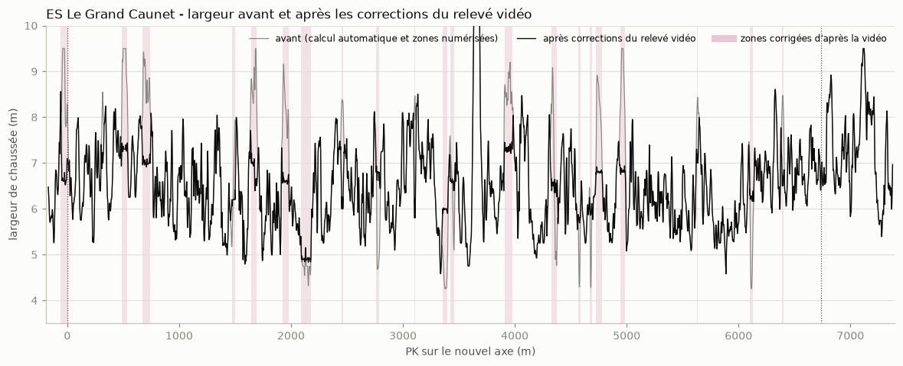

# Phase 3 : axe précis et bords de la chaussée

*10 novembre 2026, chiffres régénérés le 11 novembre après les corrections du relevé vidéo (PK 0 = départ retenu, arrivée au PK 6 722 de l'axe IGN). Document destiné au directeur de projet.*

## 1. Résultat

La chaussée est maintenant décrite **tous les mètres** entre le départ et l'arrivée : position de l'axe, des deux bords, altitude, largeur et dévers (l'inclinaison latérale de la route). C'est la base du futur modèle 3D.

- L'axe de la carte IGN, qui servait de guide, était décalé de **0,7 m en médiane et jusqu'à 4,4 m** (au PK 851) par rapport à la route réelle.
- Sur les portions dégagées, les bords tombent sur le bord visible de l'asphalte à environ 0,5 m près.
- **13 % du linéaire n'a pas pu être mesuré** et reste interpolé entre ses voisins (23 % avant les corrections du relevé vidéo). Sous les arbres, la précision peut tomber à 1 ou 2 m.
- **17 % du linéaire a reçu une largeur corrigée d'après les vidéos embarquées** (voir § 8), et 2 % a été redessiné à la main.

## 2. Méthode

Tous les mètres, un profil de 30 m de large est relevé en travers de la route dans deux sources indépendantes :

1. **Le relevé laser** (sol nu, 0,5 m) : la chaussée est une bande lisse et presque plate ; son bord est l'endroit où le terrain casse (fossé, talus, bourrelet).
2. **La photo aérienne**, en couleurs et en infrarouge (20 cm) : l'asphalte ne contient pas de chlorophylle et se distingue nettement de la végétation. Cette lecture n'est faite que là où rien ne couvre la route, ni arbre ni ombre.

Quand la photo voit le bord, elle fait foi : le relevé laser englobe parfois un accotement plat. Ailleurs, le laser décide seul. Les bords sont ensuite filtrés le long du parcours, et l'axe est le milieu des deux bords.

| Origine du bord | Part du linéaire |
|---|---:|
| Laser seul | 57,1 % |
| Largeur corrigée d'après le relevé vidéo | 17,3 % |
| Interpolé (ni laser ni photo ne tranchent) | 13,3 % |
| Laser et photo concordants | 7,2 % |
| Photo seule | 3,5 % |
| Redessiné à la main | 1,6 % |

## 3. Chiffres

| | |
|---|---:|
| Longueur départ-arrivée sur le nouvel axe | 6 736 m |
| Largeur médiane | 6,42 m |
| Largeur, 90 % des cas | 5,24 à 7,82 m |
| Dévers, 98 % des cas | entre −9 % et +9 % |
| Décalage avec l'axe IGN : médiane, 95 %, maximum | 0,70 m, 2,41 m, 4,37 m |

**Sur la longueur.** Entre les deux lignes retenues, le nouvel axe mesure 6 736 m, soit 34 m de plus que les 6 702 m officiels (0,5 %). Vingt mètres viennent du recul de la ligne de départ ; le reste vient de l'axe IGN, fait de segments droits, qui coupait légèrement les courbes.

**Sur le dévers.** Il penche vers l'intérieur des virages et augmente quand le virage se resserre (6,5 à 7 % sous 60 m de rayon). C'est le comportement attendu d'une route, et un bon signe pour la mesure.

## 4. Limites

- **La largeur est bruitée.** Elle varie de 4 à 9,5 m alors que la route réelle varie sans doute bien moins : une partie de ces variations vient d'accotements plats comptés dans la chaussée. La largeur médiane de 6,41 m est fiable ; les valeurs locales le sont moins.
- **Sous couvert dense**, rien ne permet de vérifier : la photo ne voit pas la route.
- **Trois tronçons restent indécidables**, interpolés sur plus de 20 m : PK 451 à 473, 4 097 à 4 117 et 6 450 à 6 470. Le relevé vidéo y juge la largeur calculée plausible. Les cinq autres tronçons de ce type ont été corrigés d'après la vidéo (§ 8).
- **Deux ponts restent interpolés sur plus de 20 m** (PK 4 417 à 4 446 et 5 528 à 5 548) : le relevé vidéo y juge la largeur plausible. Les autres ponts, débouchés et le carrefour du Lion d'Or ont été corrigés à la main ou d'après la vidéo.
- **Un ponceau mal placé dans la base IGN** creusait la route de 1,5 m au PK 3 472. Il est comblé automatiquement ; le script signale ce type de creux.
- Les virages et les notes du copilote n'ont pas encore été recalculés sur ce nouvel axe.

## 5. Fichiers

| Fichier | Contenu |
|---|---|
| `data/processed/chaussee_precise.csv` | Un point par mètre : axe, bord gauche, bord droit (position et altitude), largeur, dévers, origine de la mesure |
| `data/processed/chaussee_precise.geojson` | Les trois lignes, lisibles dans QGIS ou sur geojson.io |
| `data/processed/chaussee_precise_qualite.json` | Chiffres de qualité et liste des tronçons interpolés |
| `figures/phase3/` | Planches de contrôle sur photo aérienne, courbes de largeur et de décalage |
| `scripts/07_chaussee_precise.py` | Le calcul, rejouable en 15 secondes |

## 6. Compléments du 10/11/2026 : approche, sortie et premier modèle 3D

**Chaussée prolongée.** Le calcul couvre maintenant toute la zone utile au jeu, du contrôle horaire (PK −170) à 60 m après le point stop (PK 7 377). Une colonne `zone` distingue l'approche, la spéciale et la sortie.

- La sortie est correcte.
- **L'approche est mauvaise** : plus de la moitié y est interpolée. Au carrefour D3/D3D et le long du parking, la chaussée calculée est trop large (jusqu'à 9,5 m) et son bord gauche entre dans le parking. Cette zone sera redessinée à la main.
- En passant, un défaut de méthode a été trouvé et corrigé : le résultat dépendait légèrement du point où le calcul commençait (4 cm en médiane, jusqu'à 1,8 m sur un pont). Les profils sont désormais calés sur une grille fixe.

**Premier modèle 3D** (`scripts/08_modele_3d.py`, 40 secondes) au format glTF, lisible par Blender, Unreal Engine et les visionneuses en ligne :

| Fichier | Contenu | Taille |
|---|---|---:|
| `modele/route.glb` | La chaussée : un ruban de 30 000 triangles, trois points par mètre (bord, axe, bord) pour restituer le bombement | 1,1 Mo |
| `modele/terrain.glb` | Le terrain à 130 m de part et d'autre, en 26 dalles portant chacune sa photo aérienne ; maille de 1 m près de la route, 4 m au loin | 39 Mo, non versionné |
| `modele/apercu/` | Version allégée des deux fichiers | 8,6 Mo, versionnée |
| `modele/repere.json` | Origine (le départ) et formule de passage entre les coordonnées de carte et celles du modèle | |

Contrôles faits : aucun trou entre la route et le terrain (écart vertical de 1,6 cm au pire hors ponts), toutes les faces de la route tournées vers le haut, rendu vérifié sur trois vues.

Défauts connus du modèle :
- la route est en gris uni, sans texture ni marquage ;
- les ponts n'ont ni tablier épais, ni parapets, ni piles ; sous le plus long, les parois du vallon portent une image étirée ;
- pas encore de végétation ni d'objets.

**Corrections manuelles (11/11/2026).** La zone d'approche (PK −170 à −58) et le carrefour du Lion d'Or (PK 3 612 à 3 692) ont été redessinés à la main ; le détail du carrefour est dans `07_phase4_decor.md`, § 5. De la fin du parking à 40 m après le départ, la route est sous les arbres et reste au calcul automatique.

## 7. Suite

1. ~~Redessiner à la main l'approche et le carrefour du Lion d'Or~~ : fait (§ 6).
2. ~~Lever les tronçons douteux sur la vidéo n° 2~~ : fait (§ 8). Le dégagement de stationnement à gauche du départ reste à modéliser à part.
3. Recalculer les virages et produire une première version des notes du copilote.
4. Enrichir le modèle 3D : texture et marquage de la route, parapets des ponts, placement des arbres par essence.

## 8. Corrections issues du relevé vidéo (11/11/2026)

Un autre agent a revu image par image les trois vidéos embarquées et a relevé 35 sections douteuses (`docs/08_releve_video.md`). Pour chacune, il propose une largeur et le bord à déplacer, avec un niveau de confiance. Ces propositions sont maintenant appliquées automatiquement par le calcul ; elles figurent dans une liste lisible et modifiable à la main, `largeurs`, du fichier `data/reference/chaussee_corrections.json`.

**Ce qui a été appliqué.** Vingt-quatre corrections couvrent 829 m de route, plus les raccords de 10 m à chaque extrémité :

- vingt de confiance moyenne, sur 692 m : ponts et ponceaux trop étroits (pont 2777 porté à 6,8 m, ponceaux des PK 4572, 4672 et 6110 à 5,8 à 6,3 m, ponts 1661 et 4360) ; accotements plats comptés à tort comme chaussée (PK 675-739, 1926-1980, 2453-2464, 4726-4780, 4942-4983) ; virage des PK 487-537, ramené de 9,5 à 7,3 m ; ligne de départ, ramenée à 7 m ;
- quatre de confiance faible, sur 137 m, retenues seulement parce que la largeur calculée était manifestement fausse (plus de 8 m pour une route à deux voies) : les 55 m qui précèdent le départ, où le calcul englobait le dégagement des secours, et les PK 313-319, 3907-3976 et 5631-5637.

Le rétrécissement réel avant la première épingle (PK 2092 à 2178, environ 5 m) est conservé ; seuls les points calculés sous 4,9 m y sont légèrement relevés. Au PK 3104-3109, la largeur proposée (5,8 m) a été appliquée au bord gauche et non au bord droit : sur la photo aérienne, le bord droit suit exactement la ligne de rive.

**Ce qui a été écarté.** Treize propositions n'ont pas été appliquées : soit le relevé conseille lui-même de conserver la largeur, soit il s'agit de corrections de confiance faible sur des largeurs plausibles (par exemple 4,6 à 5 m sur une route étroite). Elles sont listées dans le même fichier, avec leur motif. Le carrefour du Lion d'Or, redessiné à partir du relevé laser détaillé, n'est pas touché.

**Contrôles.** En dehors des zones corrigées, aucun point de la route n'a bougé (altitude modifiée de 1 cm au plus, dévers de 0,3 point au plus au voisinage immédiat des zones). Aux raccords, le bord ne saute jamais de plus de 0,22 m d'un mètre au suivant. Aucune maille de la route n'est retournée. Les seules largeurs supérieures à 9,5 m sont au Lion d'Or, où l'enrobé du carrefour est volontairement inclus.

**Parapets.** Le fichier `data/reference/ouvrages_parapets.json` a été mis à jour : les deux longs parapets attribués à tort aux ponceaux des PK 1484 et 1963 sont replacés le long des virages où la vidéo les montre (PK 1535-1590 et 2128-2178), et cinq ponceaux à parapets bas sont ajoutés (PK 3446, 4572, 4672, 6110 et 6685). Ces parapets ne reposent sur aucun pont détecté ; le script qui construit les ouvrages devra apprendre à les lire avant qu'ils apparaissent dans le modèle.

