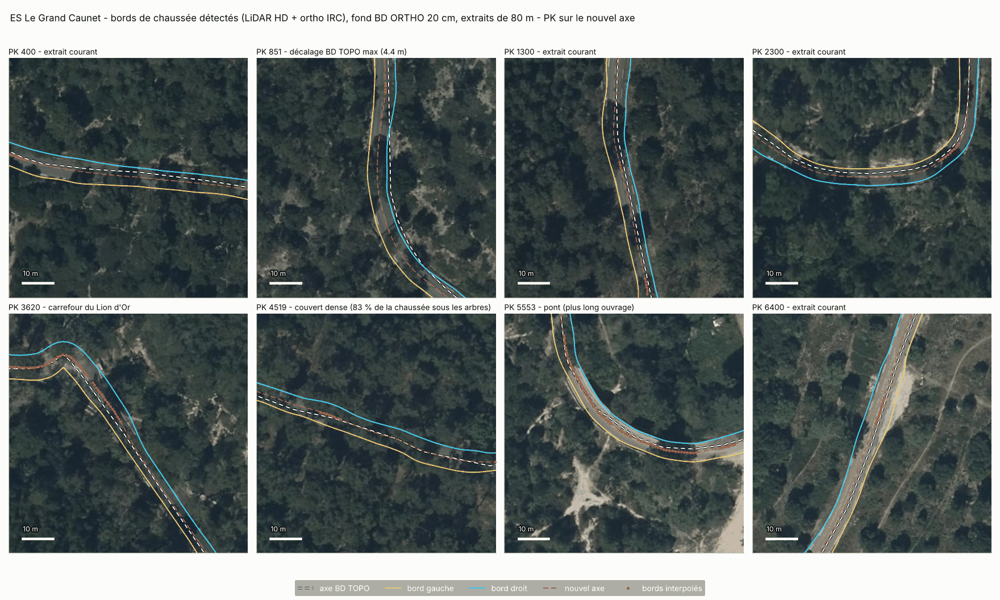
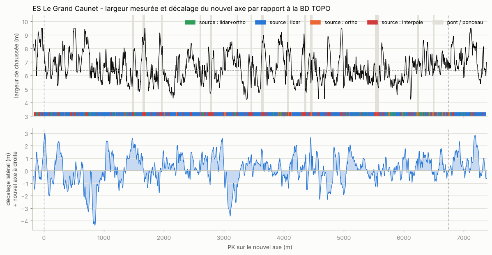
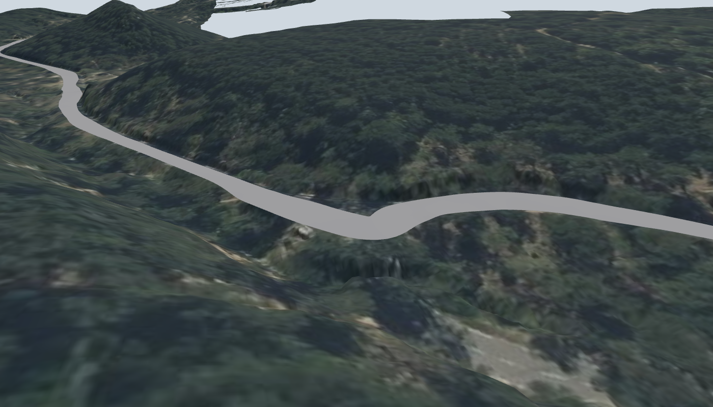

# Phase 3 : axe précis et bords de la chaussée

*10 novembre 2026, chiffres régénérés après le recul de 20 m de la ligne de départ (PK 0 = départ retenu, arrivée au PK 6 722 de l'axe IGN). Document destiné au directeur de projet.*

## 1. Résultat

La chaussée est maintenant décrite **tous les mètres** entre le départ et l'arrivée : position de l'axe, des deux bords, altitude, largeur et dévers (l'inclinaison latérale de la route). C'est la base du futur modèle 3D.

- L'axe de la carte IGN, qui servait de guide, était décalé de **0,7 m en médiane et jusqu'à 4,4 m** (au PK 851) par rapport à la route réelle.
- Sur les portions dégagées, les bords tombent sur le bord visible de l'asphalte à environ 0,5 m près.
- **Près d'un quart du linéaire (22,8 %) n'a pas pu être mesuré** et a été interpolé entre ses voisins. Sous les arbres, la précision peut tomber à 1 ou 2 m.

## 2. Méthode

Tous les mètres, un profil de 30 m de large est relevé en travers de la route dans deux sources indépendantes :

1. **Le relevé laser** (sol nu, 0,5 m) : la chaussée est une bande lisse et presque plate ; son bord est l'endroit où le terrain casse (fossé, talus, bourrelet).
2. **La photo aérienne**, en couleurs et en infrarouge (20 cm) : l'asphalte ne contient pas de chlorophylle et se distingue nettement de la végétation. Cette lecture n'est faite que là où rien ne couvre la route, ni arbre ni ombre.

Quand la photo voit le bord, elle fait foi : le relevé laser englobe parfois un accotement plat. Ailleurs, le laser décide seul. Les bords sont ensuite filtrés le long du parcours, et l'axe est le milieu des deux bords.

| Origine du bord | Part du linéaire |
|---|---:|
| Laser seul | 64,7 % |
| Interpolé (ni laser ni photo ne tranchent) | 22,8 % |
| Laser et photo concordants | 8,2 % |
| Photo seule | 4,2 % |

## 3. Chiffres

| | |
|---|---:|
| Longueur départ-arrivée sur le nouvel axe | 6 736 m |
| Largeur médiane | 6,41 m |
| Largeur, 90 % des cas | 5,07 à 8,43 m |
| Dévers, 98 % des cas | entre −9 % et +9 % |
| Décalage avec l'axe IGN : médiane, 95 %, maximum | 0,67 m, 2,28 m, 4,37 m |

**Sur la longueur.** Entre les deux lignes retenues, le nouvel axe mesure 6 736 m, soit 34 m de plus que les 6 702 m officiels (0,5 %). Vingt mètres viennent du recul de la ligne de départ ; le reste vient de l'axe IGN, fait de segments droits, qui coupait légèrement les courbes.

**Sur le dévers.** Il penche vers l'intérieur des virages et augmente quand le virage se resserre (6,5 à 7 % sous 60 m de rayon). C'est le comportement attendu d'une route, et un bon signe pour la mesure.

## 4. Limites

- **La largeur est bruitée.** Elle varie de 4 à 9,5 m alors que la route réelle varie sans doute bien moins : une partie de ces variations vient d'accotements plats comptés dans la chaussée. La largeur médiane de 6,41 m est fiable ; les valeurs locales le sont moins.
- **Sous couvert dense**, rien ne permet de vérifier : la photo ne voit pas la route.
- **Huit tronçons indécidables**, interpolés sur plus de 20 m : PK 451 à 473, 492 à 528, 706 à 731, 2 735 à 2 757, 4 097 à 4 117, 4 726 à 4 780, 4 942 à 4 983 et 6 450 à 6 470. Par endroits la largeur atteint le plafond de 9,5 m : probablement des refuges ou des surlargeurs revêtues. À confirmer sur vidéo embarquée.
- **Huit autres tronçons interpolés** correspondent à des ponts et à des débouchés de pistes, dont le carrefour du Lion d'Or (PK 3 644 à 3 683), où la forme exacte du virage reste à dessiner.
- **Un ponceau mal placé dans la base IGN** creusait la route de 1,5 m au PK 3 472. Il est comblé automatiquement ; le script signale ce type de creux.
- Les virages et les notes du copilote n'ont pas encore été recalculés sur ce nouvel axe.

## 5. Fichiers

| Fichier | Contenu |
|---|---|
| `data/processed/chaussee_precise.csv` | Un point par mètre : axe, bord gauche, bord droit (position et altitude), largeur, dévers, origine de la mesure |
| `data/processed/chaussee_precise.geojson` | Les trois lignes, lisibles dans QGIS ou sur geojson.io |
| `data/processed/chaussee_precise_qualite.json` | Chiffres de qualité et liste des tronçons interpolés |
| `figures/phase3/` | Planches de contrôle sur photo aérienne, courbes de largeur et de décalage |
| `scripts/07_chaussee_precise.py` | Le calcul, rejouable en 15 secondes |

## 6. Compléments du 10/11/2026 : approche, sortie et premier modèle 3D

**Chaussée prolongée.** Le calcul couvre maintenant toute la zone utile au jeu, du contrôle horaire (PK −170) à 60 m après le point stop (PK 7 377). Une colonne `zone` distingue l'approche, la spéciale et la sortie.

- La sortie est correcte.
- **L'approche est mauvaise** : plus de la moitié y est interpolée. Au carrefour D3/D3D et le long du parking, la chaussée calculée est trop large (jusqu'à 9,5 m) et son bord gauche entre dans le parking. Cette zone sera redessinée à la main.
- En passant, un défaut de méthode a été trouvé et corrigé : le résultat dépendait légèrement du point où le calcul commençait (4 cm en médiane, jusqu'à 1,8 m sur un pont). Les profils sont désormais calés sur une grille fixe.

**Premier modèle 3D** (`scripts/08_modele_3d.py`, 40 secondes) au format glTF, lisible par Blender, Unreal Engine et les visionneuses en ligne :

| Fichier | Contenu | Taille |
|---|---|---:|
| `modele/route.glb` | La chaussée : un ruban de 30 000 triangles, trois points par mètre (bord, axe, bord) pour restituer le bombement | 1,1 Mo |
| `modele/terrain.glb` | Le terrain à 130 m de part et d'autre, en 26 dalles portant chacune sa photo aérienne ; maille de 1 m près de la route, 4 m au loin | 39 Mo, non versionné |
| `modele/apercu/` | Version allégée des deux fichiers | 8,6 Mo, versionnée |
| `modele/repere.json` | Origine (le départ) et formule de passage entre les coordonnées de carte et celles du modèle | |

Contrôles faits : aucun trou entre la route et le terrain (écart vertical de 1,6 cm au pire hors ponts), toutes les faces de la route tournées vers le haut, rendu vérifié sur trois vues.

Défauts connus du modèle :
- la route est en gris uni, sans texture ni marquage ;
- les ponts n'ont ni tablier épais, ni parapets, ni piles ; sous le plus long, les parois du vallon portent une image étirée ;
- pas encore de végétation ni d'objets.

## 7. Suite

1. Redessiner à la main l'approche (carrefour D3/D3D, parking) et le carrefour du Lion d'Or.
2. Lever les tronçons douteux sur la vidéo n° 2 ; trancher la position de la ligne de départ (voir `references_videos.md`).
3. Recalculer les virages et produire une première version des notes du copilote.
4. Enrichir le modèle 3D : texture et marquage de la route, parapets des ponts, placement des arbres par essence.
