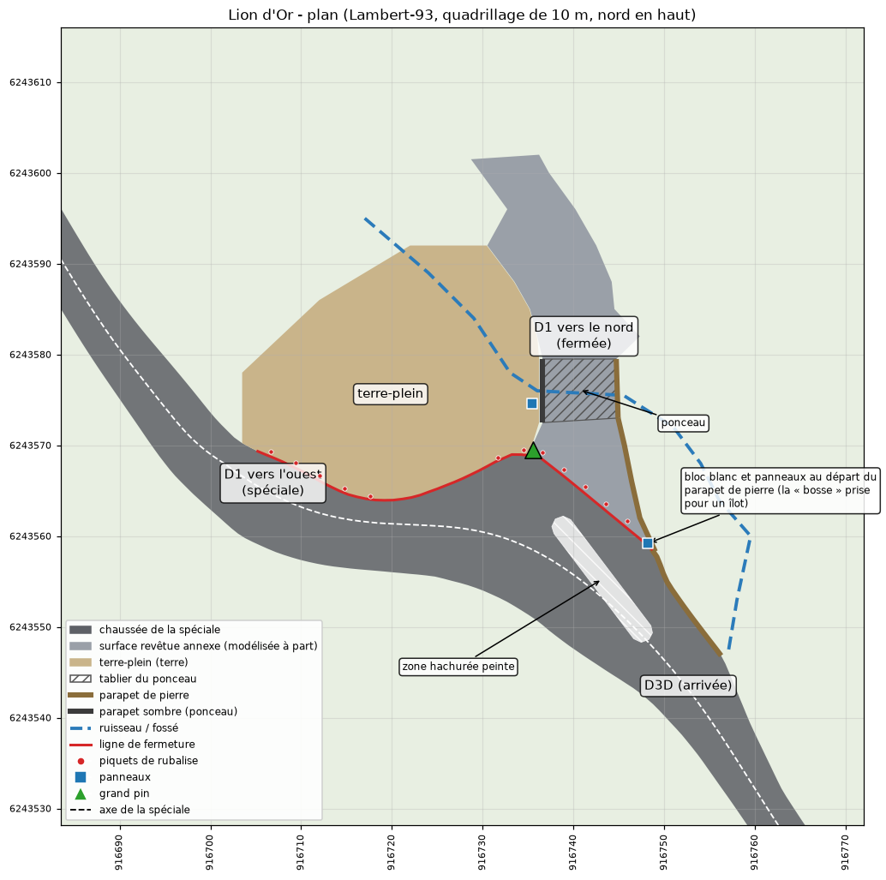
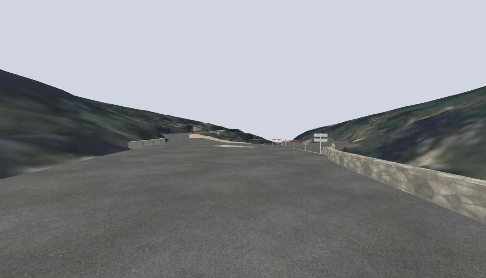

# Phase 4 : habillage de la route, ponts et végétation

*11 novembre 2026. Document destiné au directeur de projet.*

## 1. Résultat

Le modèle 3D neutre contient maintenant une route texturée et marquée, les douze ponts avec leurs parapets, des glissières, les carrefours avec leurs voies fermées, et un semis de 41 600 arbres avec leur position, leur hauteur et leur essence. Rien de cela n'a encore été vu dans le jeu.

## 2. Route

`scripts/11_route_ouvrages.py` produit `modele/route_habillee.glb`.

- **Asphalte** : une texture d'enrobé calculée, sans raccord visible et sans ressource externe.
- **Marquage** : ligne axiale et lignes de rive, en fines bandes posées 1,5 cm au-dessus de la chaussée. Les tronçons et les types de ligne sont dans `data/reference/marquage_route.json`, modifiable à la main.

| Élément | Valeur retenue | Origine |
|---|---|---|
| Ligne axiale | Discontinue, traits de 3 m espacés de 10 m | Réglementation française, citée de mémoire ; type de ligne confirmé par la vidéo, longueurs non mesurées |
| Lignes de rive | Discontinues, traits de 3 m espacés de 3,5 m | Idem |
| Largeur des lignes | 12 cm | Supposée |
| Lignes de rive continues | 15 m de part et d'autre de chaque pont | Vues sur la vidéo à quatre ponts, généralisées aux autres |
| Ligne axiale continue | PK 3 560 à 3 625, avant le Lion d'Or | Vue sur la vidéo |
| Sans ligne de rive | Ponts des PK 4 300 à 4 520 | Vu sur la vidéo |

Non modélisé : le marquage du carrefour du Lion d'Or, les lignes continues en courbe et les traits serrés d'avertissement, vus sur la vidéo mais non relevés.

## 3. Ponts

Chaque pont a un tablier épais de 0,6 m, des culées qui descendent jusqu'au sol et des parapets. Le type et la hauteur ont été relevés pont par pont sur la vidéo de jour (`data/reference/ouvrages_parapets.json`). Les hauteurs sont estimées à l'œil, à 15 cm près.

| PK | Longueur | Parapets |
|---|---:|---|
| 1 483 | 3 m | Pierre à dés blancs à droite, aucun à gauche |
| 1 653 | 17 m | Pierre à dés blancs des deux côtés, 0,75 m |
| 1 962 | 3 m | Pierre à dés blancs à droite, aucun à gauche |
| 2 601 | 4 m | Pierre, 0,6 m |
| 2 773 | 10 m | Pierre à dés blancs, 0,7 m |
| 3 221 | 17 m | Pierre, 0,7 m |
| 3 638 (Lion d'Or) | 20 m | Béton bas, 0,5 m ; côté droit supposé |
| 4 072 | 5 m | Pierre, 0,6 à 0,75 m |
| 4 352 | 17 m | Pierre à dés blancs |
| 4 455 | 17 m | Pierre à dés blancs |
| 5 522 | 65 m | Béton, 0,8 m |
| 6 488 | 10 m | Béton, 0,7 m |

La vidéo a corrigé une idée fausse : trois ponts de la D1 ont des parapets de pierre, pas de béton.

Limites : la longueur réelle des parapets est supposée ; sous les ponts, le terrain porte encore une image grise étirée ; il n'y a ni glissières ni murets (la carte IGN n'en signale aucun à moins de 15 m de la route).

## 4. Végétation

`scripts/10_semis_arbres.py` produit `data/processed/arbres.csv` et `arbustes.csv.gz`, sur 135 m de part et d'autre de la route.

**Méthode.** Chaque sommet d'arbre est repéré dans le relevé laser (différence entre la surface et le sol), et son houppier est délimité. L'essence est tirée au sort selon la carte forestière de l'IGN : c'est une attribution statistique, juste en moyenne par parcelle, pas une identification arbre par arbre.

| | |
|---|---:|
| Arbres détectés | 41 579 |
| dont à moins de 40 m de la route | 10 163 |
| dont à moins de 15 m | 2 881 |
| Hauteur médiane | 6,5 m |
| Un arbre sur dix dépasse | 14,6 m |
| Part du couvert de plus de 2 m expliquée par un arbre détecté | 87 % |
| Arbustes semés (positions fictives, densité réelle) | 122 753 |

| Essence | Part | Élément du jeu proposé |
|---|---:|---|
| Pin d'Alep | 55 % | `AleppoPine` (15 modèles) |
| Chêne vert | 39 % | **À arbitrer** |
| Chêne pubescent | 5 % | `Blackmaple` |
| Autres (pin, cyprès, olivier) | 1 % | `BlackpineMonteCarlo`, `Cypress`, `Olivetree` |
| Arbustes | | `Boxthorn`, `BroomCreeper` |

**Décision du directeur (11/11/2026) : essayer la proposition ci-dessous**, à juger ensuite en jeu.

**Le jeu n'a aucun chêne.** Or le chêne vert est notre deuxième essence. Proposition : `Smoketree` pour les sujets de moins de 6 m et `BlackmapleMonteCarlo` au-dessus, pour leur houppier dense et arrondi. Ce sont deux arbres à feuilles caduques : si le jeu les montre sans feuilles, l'olivier (`Olivetree`) conviendra mieux. Je n'ai vu que les noms de ces éléments, pas leur aspect : le choix se fera sur image, dans le jeu.

Limites : en pinède dense, les houppiers jointifs sont parfois fusionnés ou coupés, d'où 20 à 30 % d'incertitude sur le nombre d'arbres ; le sous-bois est invisible au laser ; la taille d'origine des arbres du jeu est inconnue.

## 5. Carrefour du Lion d'Or

Ce carrefour a été repris trois fois sur les remarques du directeur, photos aériennes et Street View à l'appui. La version ci-dessous est établie sur le nuage de points laser brut de l'IGN (une cinquantaine de points par mètre carré), où parapets, panneaux et fossé se lisent directement.

**Ce qu'est réellement le carrefour**

- La D3D arrive du sud-est sur une fourche. La spéciale prend la branche de gauche, vers la D1 direction Roquefort.
- La branche de droite, vers la D1 direction nord, franchit le ruisseau sur un **ponceau**. Le parapet ouest de ce ponceau est le « parapet sombre » des photos ; les **panneaux directionnels sont plantés dans le fossé, juste derrière lui**.
- Un **parapet de pierre** longe le côté est de la D3D à partir du PK 3 629, puis la branche de droite jusqu'au ponceau.
- Entre les deux branches de la D1, il n'y a pas d'îlot mais un **terre-plein boisé**, traversé par le ruisseau, avec un grand pin de 24 m à sa pointe.
- Une **zone hachurée peinte** de 14 m de long occupe le centre de la fourche.

Mes deux premières versions étaient fausses : d'abord un tracé qui montait au centre du carrefour et tournait à angle vif, puis un « îlot » qui était en réalité le bloc de départ du parapet de pierre et un poteau de panneaux.

**Ce qui est modélisé**

- **Chaussée de la spéciale** : le bord intérieur suit le pied du talus, à la demande du directeur ; la route s'élargit jusqu'à 16,7 m dans la fourche. Le bord extérieur est la ligne de fermeture, du bloc du parapet de pierre jusqu'au pin, puis le long du terre-plein. La trajectoire médiane est une courbe à gauche régulière, de 24 m de rayon au plus serré.
- **Voies fermées** (`scripts/12_carrefours_annexes.py`) : la branche de droite et l'amorce de la D1 vers le nord, reliées par le ponceau, en enrobé ; le terre-plein en terre ; les deux parapets du ponceau, le parapet de pierre, les panneaux.
- **Fermeture** : piquets et rubalise uniquement, comme demandé (12 piquets, 9 tronçons). Sur la vidéo de 2025, un grillage orange allait du pin au bloc du parapet ; le jeu n'en propose pas en objet.

**Ce qui reste incertain**

- La position exacte de la ligne de fermeture (2 m près) et le tracé précis du parapet de pierre.
- Les limites nord et ouest du terre-plein, arbitraires.
- Six mètres de parapet de pierre, au point où la ligne de fermeture quitte le parapet (PK 3 637 à 3 640), sont retirés de l'export destiné au jeu : ils mordent de 0,3 à 0,65 m sur le couloir de la spéciale tel que le constructeur le calcule. Le parapet a donc un trou à cet endroit en jeu.

## 5 bis. Autres ajouts de la nuit du 10 au 11 novembre

- **Parapets hors pont** : sept tronçons relevés sur la vidéo sont posés sans tablier, dont deux qui avaient été attribués par erreur à des ponts voisins (ils sont en réalité aux PK 1 535 à 1 590 et 2 128 à 2 178, à droite).
- **Glissières métalliques** : six tronçons à droite, 844 m en tout (PK 1 720 à 1 793, 1 924 à 2 120, 2 247 à 2 336, 3 236 à 3 321, 3 716 à 4 006, 4 108 à 4 219), repris de l'inventaire du relevé vidéo. Leurs bornes sont connues à 10 m près ; hauteur (0,75 m) et recul (0,5 m) sont supposés. Paramètres dans `data/reference/glissieres.json`.
- **Carrefour de l'approche D3 / D3D** : 1 090 m² d'enrobé autour du carrefour, îlot en herbe compris. C'est une liaison, routes ouvertes : aucune fermeture.
- **Dégagement du départ** : 251 m² à gauche, du PK −66 au PK 0, là où stationnent les véhicules de secours ; il s'ouvre vers la sortie du parking. Son revêtement, sous les arbres, est supposé.

## 6. Fichiers

| Fichier | Contenu |
|---|---|
| `modele/route_habillee.glb` | Chaussée texturée et marquage |
| `modele/ouvrages.glb`, `ouvrages_collision.glb` | Tabliers, culées, parapets ; version simplifiée pour les chocs |
| `modele/apercu/arbres.glb` | Aperçu des arbres à moins de 40 m, en formes simples |
| `modele/annexes.glb`, `balisage.glb` et leurs versions `_collision` | Voies fermées des carrefours, terre-plein, parapets du ponceau, dégagement du départ, balisage |
| `data/processed/annexes_revetues.geojson`, `balisage.csv` | Contours des surfaces annexes ; position et type de chaque élément de balisage |
| `data/processed/arbres.csv`, `arbustes.csv.gz`, `semis_resume.json` | Le semis et ses statistiques |
| `data/reference/marquage_route.json`, `ouvrages_parapets.json`, `glissieres.json`, `chaussee_corrections.json`, `carrefours_annexes.json` | Paramètres modifiables à la main |
| `figures/phase4/` | Rendus de contrôle et planches |
