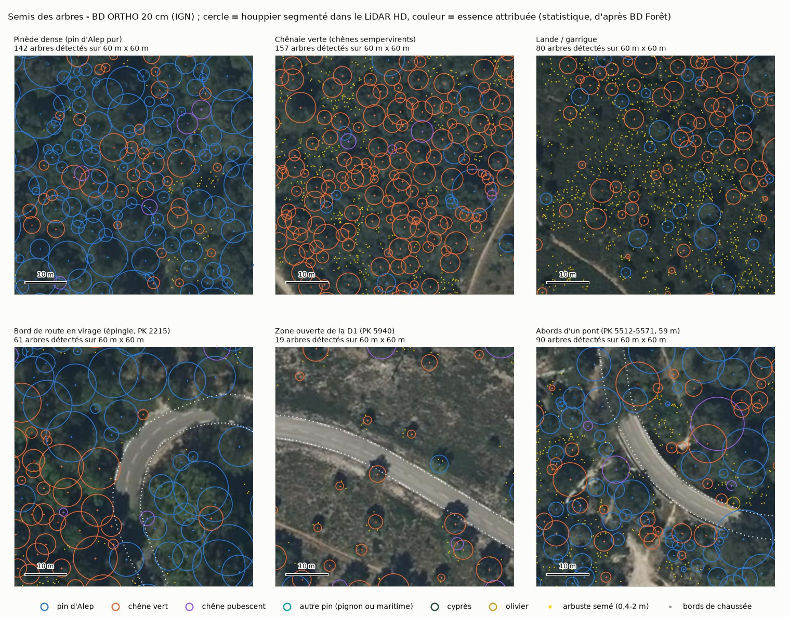
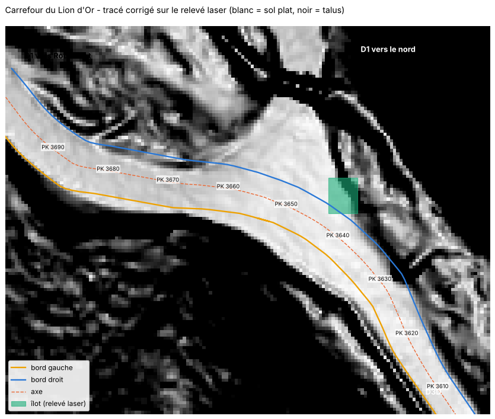
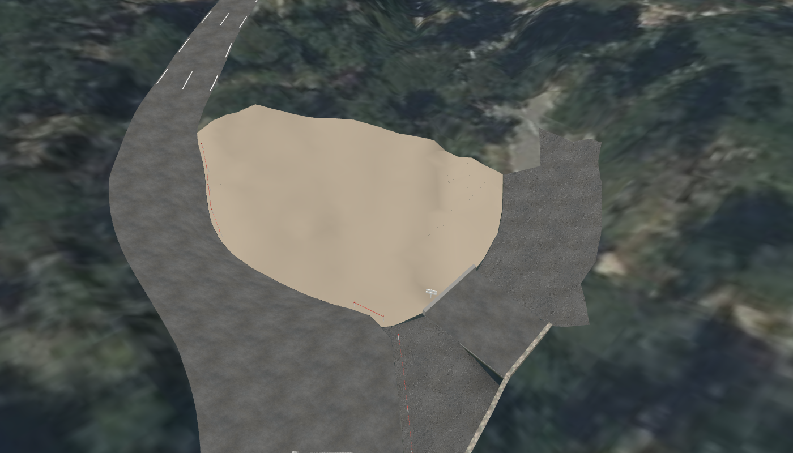

# Phase 4 : habillage de la route, ponts et végétation

*11 novembre 2026. Document destiné au directeur de projet.*

## 1. Résultat

Le modèle 3D neutre contient maintenant une route texturée et marquée, les douze ponts avec leurs parapets, et un semis de 41 600 arbres avec leur position, leur hauteur et leur essence. Rien de cela n'a encore été vu dans le jeu.

Deux points demandent l'avis du directeur : le substitut du chêne vert (§ 4) et le carrefour du Lion d'Or tel que modélisé (§ 5).

## 2. Route

`scripts/11_route_ouvrages.py` produit `modele/route_habillee.glb`.

- **Asphalte** : une texture d'enrobé calculée, sans raccord visible et sans ressource externe.
- **Marquage** : ligne axiale et lignes de rive, en fines bandes posées 1,5 cm au-dessus de la chaussée. Les tronçons et les types de ligne sont dans `data/reference/marquage_route.json`, modifiable à la main.

| Élément | Valeur retenue | Origine |
|---|---|---|
| Ligne axiale | Discontinue, traits de 3 m espacés de 10 m | Réglementation française, citée de mémoire ; type de ligne confirmé par la vidéo, longueurs non mesurées |
| Lignes de rive | Discontinues, traits de 3 m espacés de 3,5 m | Idem |
| Largeur des lignes | 12 cm | Supposée |
| Lignes de rive continues | 15 m de part et d'autre de chaque pont | Vues sur la vidéo à quatre ponts, généralisées aux autres |
| Ligne axiale continue | PK 3 560 à 3 625, avant le Lion d'Or | Vue sur la vidéo |
| Sans ligne de rive | Ponts des PK 4 300 à 4 520 | Vu sur la vidéo |

Non modélisé : le marquage du carrefour du Lion d'Or, les lignes continues en courbe et les traits serrés d'avertissement, vus sur la vidéo mais non relevés.

## 3. Ponts

Chaque pont a un tablier épais de 0,6 m, des culées qui descendent jusqu'au sol et des parapets. Le type et la hauteur ont été relevés pont par pont sur la vidéo de jour (`data/reference/ouvrages_parapets.json`). Les hauteurs sont estimées à l'œil, à 15 cm près.

| PK | Longueur | Parapets |
|---|---:|---|
| 1 483 | 3 m | Pierre à dés blancs à droite, aucun à gauche |
| 1 653 | 17 m | Pierre à dés blancs des deux côtés, 0,75 m |
| 1 962 | 3 m | Pierre à dés blancs à droite, aucun à gauche |
| 2 601 | 4 m | Pierre, 0,6 m |
| 2 773 | 10 m | Pierre à dés blancs, 0,7 m |
| 3 221 | 17 m | Pierre, 0,7 m |
| 3 638 (Lion d'Or) | 20 m | Béton bas, 0,5 m ; côté droit supposé |
| 4 072 | 5 m | Pierre, 0,6 à 0,75 m |
| 4 352 | 17 m | Pierre à dés blancs |
| 4 455 | 17 m | Pierre à dés blancs |
| 5 522 | 65 m | Béton, 0,8 m |
| 6 488 | 10 m | Béton, 0,7 m |

La vidéo a corrigé une idée fausse : trois ponts de la D1 ont des parapets de pierre, pas de béton.

Limites : la longueur réelle des parapets est supposée ; sous les ponts, le terrain porte encore une image grise étirée ; il n'y a ni glissières ni murets (la carte IGN n'en signale aucun à moins de 15 m de la route).

## 4. Végétation

`scripts/10_semis_arbres.py` produit `data/processed/arbres.csv` et `arbustes.csv.gz`, sur 135 m de part et d'autre de la route.

**Méthode.** Chaque sommet d'arbre est repéré dans le relevé laser (différence entre la surface et le sol), et son houppier est délimité. L'essence est tirée au sort selon la carte forestière de l'IGN : c'est une attribution statistique, juste en moyenne par parcelle, pas une identification arbre par arbre.

| | |
|---|---:|
| Arbres détectés | 41 579 |
| dont à moins de 40 m de la route | 10 163 |
| dont à moins de 15 m | 2 881 |
| Hauteur médiane | 6,5 m |
| Un arbre sur dix dépasse | 14,6 m |
| Part du couvert de plus de 2 m expliquée par un arbre détecté | 87 % |
| Arbustes semés (positions fictives, densité réelle) | 122 753 |

| Essence | Part | Élément du jeu proposé |
|---|---:|---|
| Pin d'Alep | 55 % | `AleppoPine` (15 modèles) |
| Chêne vert | 39 % | **À arbitrer** |
| Chêne pubescent | 5 % | `Blackmaple` |
| Autres (pin, cyprès, olivier) | 1 % | `BlackpineMonteCarlo`, `Cypress`, `Olivetree` |
| Arbustes | | `Boxthorn`, `BroomCreeper` |

**Décision du directeur (11/11/2026) : essayer la proposition ci-dessous**, à juger ensuite en jeu.

**Le jeu n'a aucun chêne.** Or le chêne vert est notre deuxième essence. Proposition : `Smoketree` pour les sujets de moins de 6 m et `BlackmapleMonteCarlo` au-dessus, pour leur houppier dense et arrondi. Ce sont deux arbres à feuilles caduques : si le jeu les montre sans feuilles, l'olivier (`Olivetree`) conviendra mieux. Je n'ai vu que les noms de ces éléments, pas leur aspect : le choix se fera sur image, dans le jeu.

Limites : en pinède dense, les houppiers jointifs sont parfois fusionnés ou coupés, d'où 20 à 30 % d'incertitude sur le nombre d'arbres ; le sous-bois est invisible au laser ; la taille d'origine des arbres du jeu est inconnue.

## 5. Carrefour du Lion d'Or : tracé corrigé

Le directeur a signalé que le tracé du carrefour était faux, vues aérienne et Street View à l'appui. Il avait raison.

- **La réalité** : la D3D débouche sur une patte d'oie. Un îlot triangulaire, avec un arbre et des panneaux, sépare une branche de gauche vers la D1 direction Roquefort et une branche de droite vers la D1 direction nord. La spéciale prend la branche de gauche.
- **L'erreur** : le calcul automatique suivait l'axe de la carte IGN jusqu'au centre du carrefour, passait en partie sur l'îlot, puis tournait à angle vif.
- **La correction** : les deux bords ont été redessinés à la main sur le relevé laser, où la plate-forme de la route et la bosse de l'îlot se lisent sous les arbres. Le tracé passe à gauche de l'îlot en courbe régulière.

**Compléments demandés par le directeur (11/11/2026).**

- **Le bord intérieur suit le pied du talus**, c'est-à-dire la limite de la plate-forme plane sur le relevé laser. La chaussée s'élargit donc à l'intérieur du virage, jusqu'à 14,8 m au plus large. Précision estimée : 1 m.
- **Les voies que la spéciale n'emprunte pas sont modélisées** (`scripts/12_carrefours_annexes.py`) : 498 m² d'enrobé en trois morceaux, soit la plaque de la D1 au nord de la ligne de fermeture (234 m²), l'embouchure de la branche de droite (110 m²) et les 40 premiers mètres de la D1 vers le nord (154 m²).
- **L'îlot est en relief** : 29 m², 0,28 m de haut, avec sa bordure, un poteau et deux panneaux.
- **Le carrefour est fermé par du balisage du jeu**, posé le long de la ligne de fermeture : une rubalise sur piquets à 0,8 m du bord, puis une file de barrières plastiques rouges et blanches à 2,5 m. Soit 20 piquets, 18 tronçons de rubalise et 29 barrières (`data/processed/balisage.csv`).

| Balisage | Élément du jeu |
|---|---|
| Piquets de rubalise | `Props/RallyProps/TapePlasticPoleA/SM_PlasticTapePoleA` |
| Ruban | `Data/Environments/Common/BC_NarrowTapeActor` |
| Barrières | `Props/RallyProps/PlasticBarrierA/SM_PlasticBarrierAFix` ; variante : barrière de foule `ServicePark/CrowdBarrier1` |
| Aussi disponibles | Cônes, bottes de paille, chicanes en bottes, panneaux « interdit au public » |

Sur la vidéo de 2025, la fermeture réelle était une rubalise rouge et blanche, puis un grillage orange sur piquets avec des panneaux à chevrons, les spectateurs derrière. Le jeu n'a ni ce grillage ni ces panneaux en objets : la barrière plastique en tient lieu.

**Corrections demandées par le directeur (11/11/2026), en cours :** il n'y a pas d'îlot à proprement parler. Les panneaux sont plantés dans le fossé, derrière un parapet, et c'est ce parapet qu'il faut modéliser ; pour la fermeture, les piquets et la rubalise suffisent, sans barrières. Le plan du carrefour est repris à partir des photos du directeur, de la vidéo et du relevé laser. Ce qui précède dans ce paragraphe décrit donc une version provisoire.

Défauts connus :
- **l'amorce de la D1 vers le nord est détachée du carrefour** : la courte descente qui les relie est trop irrégulière dans le relevé laser pour être reconnue comme de l'enrobé. À raccorder à la main ;
- un trou de 3,5 m dans l'enrobé annexe le long du bord, vers le PK 3 630 ;
- les dimensions réelles des barrières et des piquets du jeu sont inconnues : l'espacement sera à ajuster en jeu ;
- dans l'export destiné au jeu, ces surfaces annexes comptent encore comme de l'accotement et le balisage n'y figure pas : à faire ;
- le parapet droit du ponceau du Lion d'Or a été retiré, car il barrait la ligne de fermeture ; à revoir sur la vidéo.

## 6. Fichiers

| Fichier | Contenu |
|---|---|
| `modele/route_habillee.glb` | Chaussée texturée et marquage |
| `modele/ouvrages.glb`, `ouvrages_collision.glb` | Tabliers, culées, parapets ; version simplifiée pour les chocs |
| `modele/apercu/arbres.glb` | Aperçu des arbres à moins de 40 m, en formes simples |
| `modele/annexes.glb`, `balisage.glb` et leurs versions `_collision` | Voies fermées du carrefour, îlot, balisage |
| `data/processed/annexes_revetues.geojson`, `balisage.csv` | Contours des surfaces annexes ; position et type de chaque élément de balisage |
| `data/processed/arbres.csv`, `arbustes.csv.gz`, `semis_resume.json` | Le semis et ses statistiques |
| `data/reference/marquage_route.json`, `ouvrages_parapets.json`, `chaussee_corrections.json`, `carrefours_annexes.json` | Paramètres modifiables à la main |
| `figures/phase4/` | Rendus de contrôle et planches |
