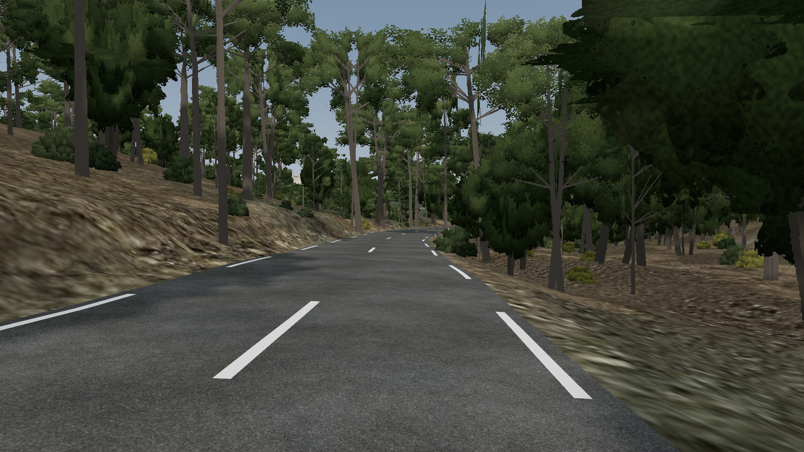
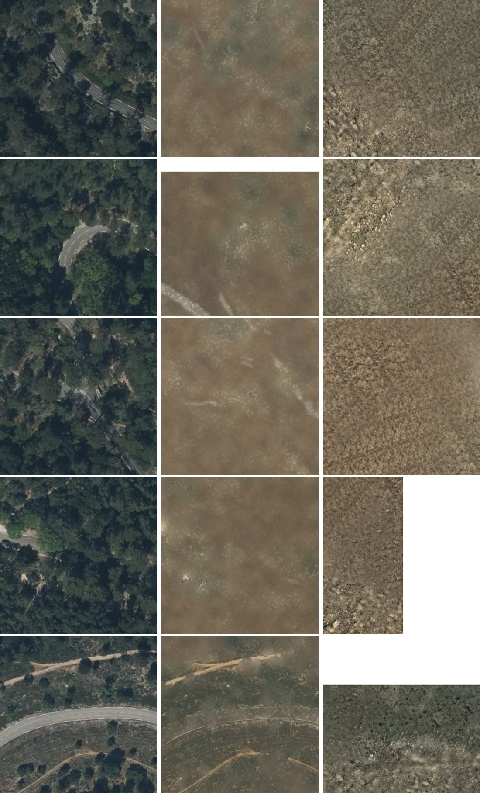
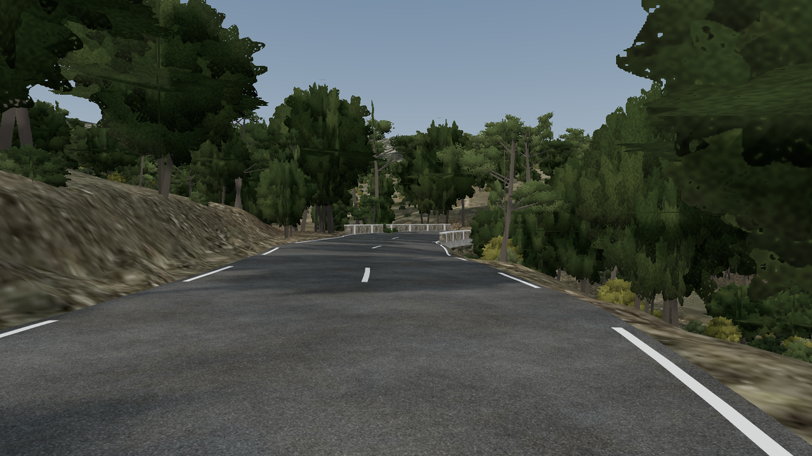

# Phase 5 : paysage lointain, sol sans les arbres, vues du décor

*11 novembre 2026. Document destiné au directeur de projet.*

## 1. Résultat

Trois éléments manquaient au décor ; ils existent maintenant dans le modèle neutre. Rien n'a encore été vu dans le jeu : les vues ci-dessous sont calculées sur le serveur, avec des arbres figurants dessinés par calcul. Elles servent à juger la composition, pas le rendu final, qui sera celui du moteur du jeu avec ses propres arbres.

## 2. Paysage lointain

`scripts/13_paysage_lointain.py` ajoute le relief autour du couloir, jusqu'à l'horizon.

- **Étendue : 30 km.** L'horizon a été calculé depuis la route tous les 100 m. Il est fermé à moins de 3 km dans 80 % des cas, mais la crête de la Sainte-Baume (1 135 m), à 10 à 24 km, se voit de plusieurs endroits.
- **La mer n'est visible d'aucun point de la route**, même sans arbres.
- La maille va de 5 m près du couloir à 200 m à l'horizon ; la photo aérienne, de 1 à 12 m par pixel.
- Le raccord avec le terrain détaillé se fait sommet à sommet, sans trou.

## 3. Sol sans les arbres

Jusqu'ici chaque dalle portait la photo aérienne brute : on y voyait le dessus des pins et leurs ombres, ce qui est faux dès qu'on pose de vrais arbres. `scripts/14_textures_sol.py` fabrique une image de sol par dalle, comme le fait BioBio.

- Là où le sol est visible sur la photo, sa couleur réelle est gardée.
- Sous les arbres et dans les ombres, soit 89 % de la surface, le sol est reconstruit : litière de pinède, garrigue caillouteuse, roche, selon la carte forestière et la pente, raccordé en couleur au sol visible voisin.
- Dans une bande de 18 m de part et d'autre de la route, le détail est porté à 5 cm par pixel avec des textures libres de droits (Poly Haven, licence CC0, listées dans `data/reference/ressources_cc0.json`).
- Une texture de relief, tirée du relevé laser, restitue talus, fossés et rochers sous un éclairage rasant.

## 4. Vues de contrôle et comparaison avec la vidéo

Six vues à hauteur de conducteur (`figures/phase5/`), comparées à la vidéo embarquée de 2025.

**Ce qui sonne juste** : le tracé, la largeur perçue, les ponts et leur position, l'horizon de la Sainte-Baume.

**Ce qui sonne faux**, par ordre de gravité :

1. **Le sous-bois est absent.** Le laser ne voit pas la végétation basse sous les arbres ; les versants paraissent clairsemés et trop clairs.
2. **Le sol est uniforme au-delà de 20 m de la route.**
3. **Les talus raides portent une image étirée**, parce que la photo est projetée à la verticale.
4. **Les accotements sont ocre gris**, alors que la vidéo de novembre montre de l'herbe verte : la photo aérienne a été prise en été.
5. **Les arbres sont des figurants** : pins trop en parasol, plans croisés visibles de près. Ce défaut disparaîtra avec les arbres du jeu.

## 5. Pour passer au jeu

`data/processed/textures_sol.json` liste, pour chaque dalle, son emprise et ses images : c'est ce fichier qui servira à fabriquer les dalles du jeu (protocole dans `pc/etape2_unreal/PROTOCOLE.md`). Il faudra aussi y ajouter un semis de sous-bois et étendre le semis d'arbres au-delà de 135 m de la route.

Les fichiers lourds (anneau lointain de 56 Mo, 216 Mo d'images de sol) ne sont pas dans le dépôt ; les scripts 13 et 14 les régénèrent en une dizaine de minutes. Une version allégée est dans `modele/apercu/`.
