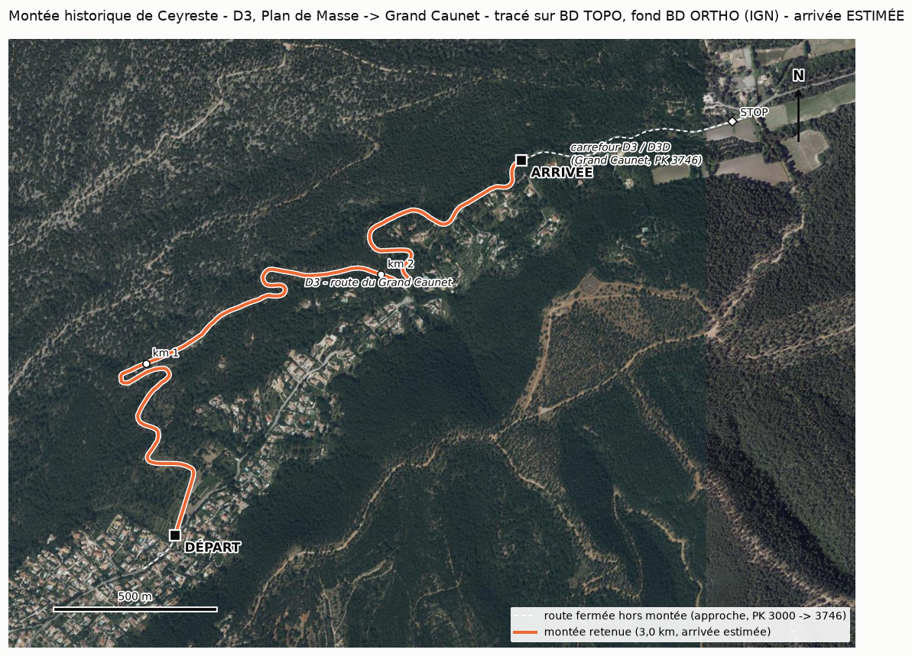

# Montée historique de Ceyreste pour Assetto Corsa Rally

Reproduction de la montée historique de Ceyreste (Bouches-du-Rhône) : la D3, « route du Grand Caunet », du carrefour du Plan de Masse vers le Grand Caunet, environ 3 km de montée (+155 m, 8 épingles). C'est une carte distincte du projet voisin `acr-grand-caunet/`, dont elle reprend une copie adaptée des scripts. Elle ne lit ni ne modifie rien de ce projet.



| Document | Contenu |
|---|---|
| [`docs/01_trace_et_sources.md`](docs/01_trace_et_sources.md) | tracé retenu, sources, ce qui est certain ou estimé |
| [`docs/02_reutilisation.md`](docs/02_reutilisation.md) | ce qui vient du Grand Caunet (fichiers, commit), ce qui est neuf ou paramétré |
| [`docs/03_affinage_reel.md`](docs/03_affinage_reel.md) | vérification du tracé et de la largeur, relevé du bord de route (Panoramax), sols, village (18/11/2026) |
| [`docs/ETAT.md`](docs/ETAT.md) | fait et vérifié, fait non vérifié, à faire sur le PC, inconnues, coexistence des deux cartes |
| [`docs/guide_pc.md`](docs/guide_pc.md) | commandes à lancer sur le PC Windows, dans l'ordre |

**Attention.** L'arrivée (PK 3000) et la ligne de départ sont **estimées** : aucun plan ni aucune vidéo embarquée n'a été trouvé. Rien n'a encore tourné dans Unreal ni dans le jeu.

## Contenu

```
epreuve.json         paramètres de l'épreuve (noms, emprise, routes, points, vues, noms du mod)
data/reference/      points de l'épreuve, relevés du site (presque vides), valeurs lues dans le jeu (copiées)
data/processed/      tracé, profil, virages, chaussée au mètre, arbres, couloir (versionnés)
data/raw/            relief 0,5 m, orthophotos (non versionnés, régénérés)
scripts/             chaîne 01 -> 16 et outils (copie adaptée de la chaîne du Grand Caunet)
figures/             figures de contrôle
modele/              modèle 3D neutre (glTF ; les gros fichiers ne sont pas versionnés)
export/stage_ir/     spéciale au format d'échange d'ACR Extra Stages (stage.json, collision.glb)
paquet_unreal/       paquet d'import Unreal (non versionné, 270 Mo, régénéré)
pc/                  kit Windows : route physique, décor Unreal, bascule entre les deux cartes
```

## Reprendre ce projet

Le dossier est autonome : il peut être copié tel quel dans un autre dépôt ou sur un autre PC. Aucun chemin absolu, aucun fichier lu en dehors de lui (le kit PC n'utilise que `ACR_JEU` et `ACR_ATELIER`, variables d'environnement facultatives).

**Prérequis** : Python 3.11 ou plus récent ; `python -m pip install -r requirements.txt` ; accès à `data.geopf.fr` (IGN) et, une fois, à `polyhaven.com` (textures CC0). Facultatif : Node.js avec Playwright (rendus de contrôle des étapes 08, 11, 15 ; sans eux, ces rendus sont sautés). Environ 2 Go de disque et 8 Go de mémoire (étape 14).

**Tout reconstruire depuis les données** (depuis ce dossier) :

```bash
python scripts/tout_lancer.py -- --sol photo
```

Durée : environ 30 à 40 minutes la première fois (téléchargements IGN, ~300 Mo dans `data/raw`), puis 20 à 25 minutes. `--sol photo` habille le terrain de la photo aérienne ; le sol « façon jeu » (`--sol jeu`, défaut de l'étape 16) demande le relevé de placement produit sur le PC (`docs/guide_pc.md`). Une étape seule : `python scripts/tout_lancer.py --seulement 9` ; la liste : `--liste`.

**Versionné** : `epreuve.json`, `data/reference/`, `data/processed/`, `figures/` (sauf aperçus lourds), `modele/apercu/` et les petits glTF, `export/stage_ir/`, `scripts/`, `pc/`, `docs/`.
**Régénéré** (ignoré par git) : `data/raw/`, `modele/terrain.glb`, `modele/terrain_sol.glb`, `modele/lointain.glb`, `modele/textures_sol/`, `modele/sols_jeu/*.npz|npy`, `paquet_unreal/`.

**Changer d'hypothèse de tracé** (par exemple arrivée à 3,5 km) : modifier `data/reference/montee_ceyreste_officiel.json` et `lignes_es.json`, puis `python scripts/tout_lancer.py --depuis 2 -- --sol photo`.

## Sources et licences

- Données géographiques : IGN (LiDAR HD, BD ORTHO, BD TOPO, BD Forêt, RGE ALTI), Licence Ouverte Etalab 2.0.
- Tracé : articles de presse et fiche de l'organisateur (Phocéa Productions), cités dans `docs/01_trace_et_sources.md`.
- Imagerie de rue : Panoramax, collection Région Sud / Immergis du 08/09/2025, Licence Ouverte Etalab 2.0 (images non versionnées ; liste dans `data/reference/photos_rue_panoramax.csv` ; extraits dans `figures/affinage/comparaison/`, mention sur chaque planche). OpenStreetMap (ODbL) pour le contrôle de l'axe et le village.
- Textures : Poly Haven (CC0), crédits dans `data/reference/ressources_cc0.json`.
- Kit PC : ACR Extra Stages (MIT / Apache-2.0), retouches dans `pc/patches/` sous les mêmes licences.
- Scripts : repris du projet `acr-grand-caunet` du même dépôt (provenance dans `docs/02_reutilisation.md`).
